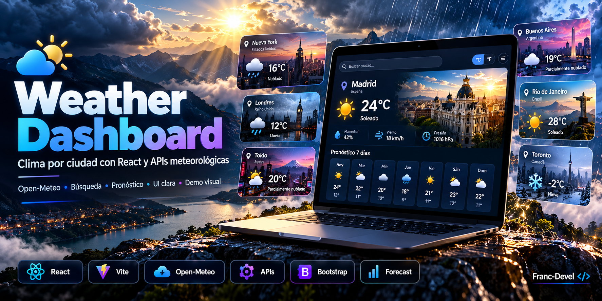

# Weather Dashboard · Consulta de clima



> **Ilustración conceptual · No es una captura de una aplicación real.** Las cifras, métricas, pantallas y módulos del mockup son ficticios y no acreditan funcionalidades, resultados ni garantías. Temperaturas, ciudades y condiciones son ficticias. El pronóstico de siete días y los paneles mostrados son conceptuales y no acreditan funcionalidades implementadas ni datos meteorológicos actuales.
>
> **Concept artwork · Not an actual application screenshot.** Figures, metrics, screens and modules are fictional; they do not substantiate implemented features, measured results or security guarantees. Refer to the documentation below for the project’s actual scope.

Aplicación de aprendizaje con React y Vite que busca una ciudad y muestra su temperatura actual, máxima y mínima del día y condición meteorológica. Desarrollada por Francisco Delgado como parte de su formación Full Stack.

## Qué demuestra

- Consumo de dos APIs REST: búsqueda de coordenadas y consulta meteorológica.
- Estado de carga, resultados y error con React.
- Formulario con React Hook Form y componentes de React Bootstrap.
- Separación entre consulta de datos y componentes de presentación.

## Tecnologías

React, Vite, JavaScript, Bootstrap, React Bootstrap, React Hook Form y Fetch API. Las versiones y scripts se encuentran en [package.json](package.json).

## Ejecución local

Requiere Node.js compatible con la versión de Vite declarada en el proyecto y npm.

```bash
git clone https://github.com/Franc-Devel/apiClima.git
cd apiClima
npm ci
npm run dev
```

Abrir la dirección indicada por Vite. Para revisar la compilación y las reglas de código:

```bash
npm run build
npm run lint
npm run preview
```

Estos comandos están definidos en el proyecto; su inclusión aquí no implica que hayan pasado en todos los entornos.

## Organización

| Archivo | Responsabilidad |
| --- | --- |
| [src/App.jsx](src/App.jsx) | Estado, consultas HTTP y adaptación de respuestas. |
| [src/components/Buscador.jsx](src/components/Buscador.jsx) | Entrada y validación de la ciudad. |
| [src/components/DataCard.jsx](src/components/DataCard.jsx) | Presentación del resultado. |
| [src/components/ErrorCard.jsx](src/components/ErrorCard.jsx) | Mensaje de error. |
| [src/index.css](src/index.css) | Estilos de la interfaz. |

## APIs y límites

La aplicación consulta [Open-Meteo Geocoding](https://geocoding-api.open-meteo.com/) y [Open-Meteo Forecast](https://api.open-meteo.com/), sin una clave configurada en el cliente.

Selecciona el primer resultado de geocodificación: una ciudad con nombres repetidos puede requerir mayor precisión. Las máximas y mínimas corresponden al día consultado; la interfaz no ofrece un pronóstico completo de siete días. La disponibilidad depende de los servicios externos y de la conexión.

El tratamiento explícito de códigos HTTP, la cancelación de búsquedas anteriores y las pruebas automatizadas quedan como mejoras técnicas. No se presenta como un servicio meteorológico de producción.

## Contacto

[Francisco Delgado en GitHub](https://github.com/Franc-Devel) · [LinkedIn](https://www.linkedin.com/in/francisco-delgado-ojeda/)

## English

Learning project built with React and Vite. It geocodes a city through Open-Meteo and displays current temperature, today's minimum and maximum, and weather conditions. Run the commands above to start the app. City lookup uses the first match; availability depends on external APIs. This repository demonstrates API integration and UI state management.
